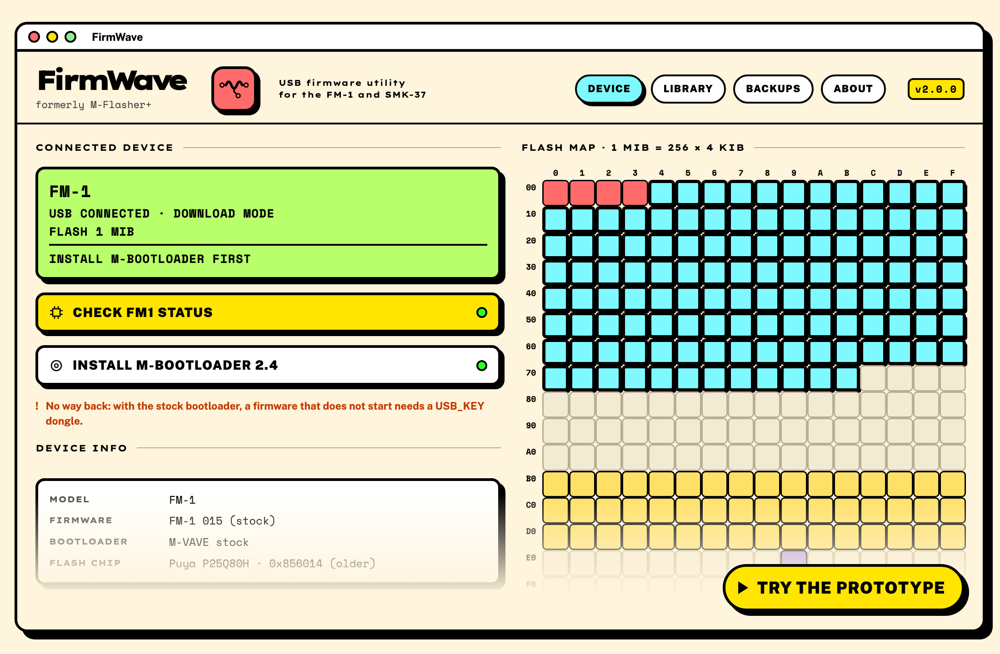
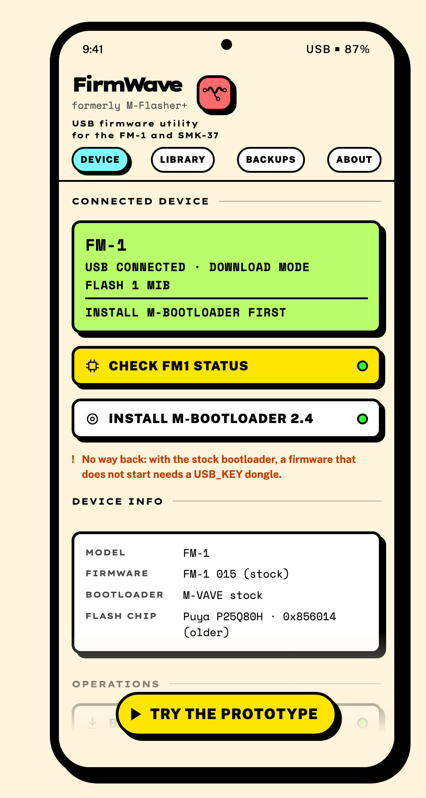
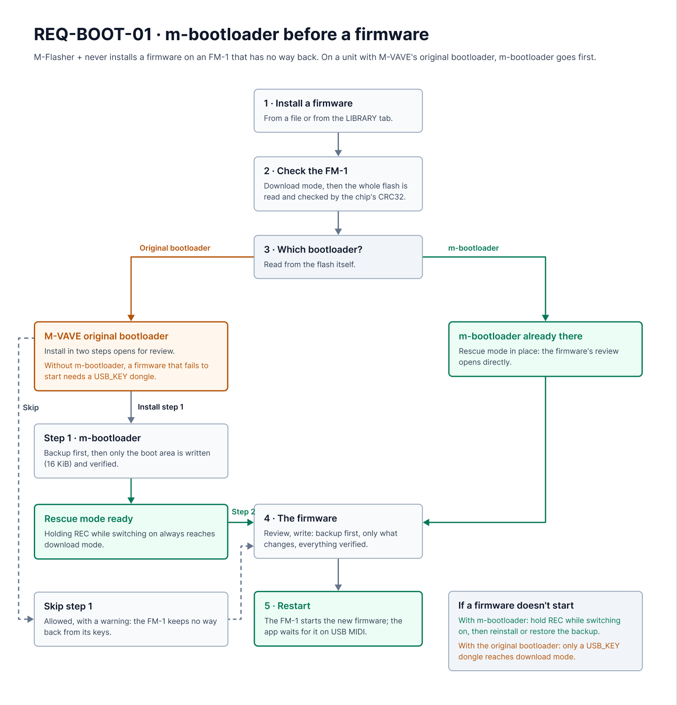

# M-Flasher +

> **No release to download right now.** Versions 1.0.0 and 1.0.1 were
> withdrawn: they had bugs, among them a wrong identification of the app when
> it reads the firmware list. Version 1.0.2, which fixes them, is being
> prepared and will be published in the [releases](../../releases) soon. If
> you installed 1.0.0 or 1.0.1, please replace it with 1.0.2 when it is out.

**Free for macOS and Android.** Download it from the
[releases](../../releases). (Windows and Linux build from the same code, as
M-Flasher's do, but this version has not been tested on them yet.)

Back up, restore and reinstall the firmware of an **M-VAVE FM-1** (or its
rebranded twin, the **Fame MiniFM**) or **SMK-37 Pro / Elite** over USB, with
a **built-in firmware library** and a safer way to install. It talks to the
chip's built-in USB download mode, so it also works when the firmware on the
unit is broken.

M-Flasher + is [M-Flasher](https://github.com/jvitkauskas/m-flasher) by Julius
Vitkauskas, extended by [Wellington Saam](https://github.com/wellingtonsaam).

> Unofficial: not affiliated with M-VAVE or JieLi. It saves a backup before it
> writes anything and checks every write, but use it at your own risk.

## Try it in your browser

Click a screen to open the interactive prototype of that app, with a simulated
FM-1. Nothing is connected or written.

&nbsp;&nbsp;

The prototype's source is [docs/prototype/index.html](docs/prototype/index.html).

## Why M-Flasher +

M-Flasher is ingenious and reliable: it reaches the chip's download mode, reads
and writes the flash safely, and verifies everything. Two things were missing:

- **A firmware library inside the app.** Finding a firmware meant searching
  forums and releases, downloading a package and choosing the file by hand.
  M-Flasher + lists the community firmwares, downloads them from their
  authors' releases, checks each one by SHA-256 and keeps it on your computer
  or phone, so it installs **offline** too.
- **A design that guides the user.** The window puts every action on one
  screen, for every situation at once. As a Product Designer, I mapped the use
  cases of the app (no unit, a unit to check, one to protect, one to flash)
  and am rebuilding the Device tab around them: **check the FM-1 first,
  protect it, then operate**.

## REQ-BOOT-01: m-bootloader before a firmware

**M-Flasher + never installs a firmware on an FM-1 that has no way back.**

An FM-1 with M-VAVE's original bootloader has one weakness: if a new firmware
does not start, its keys can't reach download mode any more, and only a
USB_KEY dongle can rescue it. [m-bootloader](https://github.com/jvitkauskas/m-bootloader)
fixes that: with it, holding **REC** while switching on always opens download
mode, whatever the firmware does.

So, on a unit with the original bootloader, installing a firmware (from a file
or from the library) happens in **two reviewed steps**: m-bootloader first,
then the firmware. Each step is backed up first and verified. The first step
can be skipped, with a clear warning.

## The new flash chip: no firmware that would brick it

**M-Flasher + checks your FM-1's flash chip, and refuses a firmware made only
for the older one before anything is written.**

FM-1s sold from late 2026 have a new flash chip:

| | Older FM-1 | Newer FM-1 |
|---|---|---|
| Flash chip | Puya P25Q80H · `0x856014` | UCUN UC25HQ80 · `0xB36014` |

Some community firmwares are made for the older chip only. On a newer FM-1
they may not start, and the unit is bricked until it is reflashed. So, for
every firmware of the library:

- M-Flasher + reads the chip when it checks the FM-1, and shows it under
  **DEVICE INFO** by name, such as *UCUN UC25HQ80 · 0xB36014 (new)*.
- **This unit only** hides the firmwares marked for the older chip.
- **INSTALL refuses them** on a newer FM-1, with *WARNING: NEW UCUN UC25HQ80
  CHIP*: nothing is written.

The marks come from [The Firmware Hub](https://thefirmwarehub.com)'s list. A
package you choose yourself (**CHOOSE FILE**) carries no such mark: check its
author's notes for the chip.

## Which firmware is on your FM-1

**M-Flasher + shows the firmware by the name you chose it by, not only by
what it calls itself.**

A firmware names itself inside its code, and one built from another keeps
that one's name: a firmware made from Felucca shows as *Felucca*, and one made
from M-VAVE's SDK as *FM-1 901*. So, under **DEVICE INFO › FIRMWARE**,
M-Flasher + looks for its name in this order:

1. **What it installed.** After every install, M-Flasher + keeps a
   fingerprint of the firmware's code (the SHA-256 of its sectors, not of its
   settings, which change as you play) with the name it was chosen by, in
   `installed.json` next to the backups. Read later, the same code shows by
   that name: *zp12 2.5 · Felucca*.
2. **The library.** Otherwise, a package saved in the **LIBRARY** that is
   identical to what is on the FM-1.
3. **What the firmware calls itself**, as before: *SLOOP 2.8.5*, *Felucca*,
   *FM-1 901*.

The name it was chosen by comes first, and what the firmware calls itself
after it. The notice at the end of an install says it too: *ZP12-2.5 RUNNING*.

## Suggestion for firmware authors: give your firmware its own name

If you make a firmware for the FM-1, here is a small suggestion that would
help people recognise it by its own name, in M-Flasher + and in other tools:

- a line with your firmware's name and version somewhere in its code, such as
  `zp12 2.5`, much as SLOOP does with `SLOOP 2.8.5`;
- your firmware's own name for its USB MIDI port, rather than the name of the
  firmware it started from.

Only if it suits your project, of course. If you would like M-Flasher + to
recognise your firmware by that line, you are welcome to open an issue with
it.

## What's new in M-Flasher +

- **Firmware library** (LIBRARY tab): the community firmwares listed by
  [The Firmware Hub](https://thefirmwarehub.com), with search, favorites,
  betas and **This unit only** (hides what can't go on your FM-1, such as a
  firmware for the older flash chip). **GET** downloads and checks by
  SHA-256; **INSTALL** plans it and opens its review.
- **REQ-BOOT-01**: m-bootloader before a firmware, as above.
- **Chip check**: a firmware made for the older flash chip is refused on a
  newer FM-1, as above.
- **Firmware names**: the firmware is shown by the name it was installed by
  (*zp12 2.5 · Felucca*), as above.
- **SAFETY CHECK**: recovery, backup, firmware and chip, at a glance.
- **No keys to remember**: INSTALL and CHECK FM1 STATUS switch a running
  unit to download mode by a MIDI message. If its firmware does not
  know it, the app says which keys do it on *that* unit, and carries on when
  it shows up.
- **Restart after writing**: the FM-1 leaves download mode by itself and the
  app tells you when the new firmware is running.
- **Android app**: the same core on a phone, over a USB OTG cable: read the
  unit, back up, install from the library, restore.
- **The Device tab, redesigned** around the use cases: **CHECK FM1 STATUS**
  and **INSTALL M-BOOTLOADER** first, then the unit's details, and each
  operation's form shown only when it is chosen.
- **Backups named by the firmware**: *fm1-zp12-2.5-20261116-165332.bin*.

## Getting started

1. Download M-Flasher + from the [releases](../../releases): the macOS disk
   image or the Android APK. The Mac app is not signed with an Apple
   certificate: the first time, macOS blocks it; allow it in **System
   Settings › Privacy & Security › Open Anyway**. On Android, allow installing
   apps from your browser or file manager.
2. Connect the FM-1 with a USB **data** cable (on a phone: a USB OTG adapter)
   and switch it on.
3. Pick a firmware in the **LIBRARY** tab and press **INSTALL**: M-Flasher +
   switches the FM-1 to download mode, reads it and opens the review. Nothing
   is written until you confirm. To start with a backup, press **CHECK FM1
   STATUS**, then **BACKUP FULL FLASH**.

## More

- [Using M-Flasher](docs/usage.md): each system, download mode, the actions,
  the firmware library, the command line
- [Safety](docs/safety.md): what is checked before and after every write,
  REQ-BOOT-01
- [How it works](docs/development.md): the protocol, the source, building

## Privacy

M-Flasher + talks to the unit over USB. It goes online only for the firmware
library: it reads The Firmware Hub's public list (at most once a day) and
downloads the firmware you choose from its author's release. Nothing about you
or your unit is sent.

## Credits and license

MIT ([LICENSE](LICENSE)).

- **M-Flasher** by [Julius Vitkauskas](https://github.com/jvitkauskas): the
  app this is built on. If it helped you, support his work:
  [GitHub Sponsors](https://github.com/sponsors/jvitkauskas) ·
  [Ko-fi](https://ko-fi.com/jvitkauskas).
- **M-Flasher +** by [Wellington Saam](https://github.com/wellingtonsaam): the
  firmware library, REQ-BOOT-01, the use cases of the redesign and the
  Android app.
- [m-bootloader](https://github.com/jvitkauskas/m-bootloader) (MIT): the
  bootloader and the flash loader.
- Firmware list: [The Firmware Hub](https://thefirmwarehub.com) (CC BY 4.0);
  each firmware belongs to its author, under its own license.
- Bundled files and their licenses: [data/NOTICE.md](data/NOTICE.md) and
  [assets/README.md](assets/README.md). The protocol follows
  [jl-uboot-tool](https://github.com/kagaimiq/jl-uboot-tool) by kagaimiq, and
  the safety rules those of
  [MvaveFM1Unbricker](https://github.com/Quixotic7/MvaveFM1Unbricker) and
  [FM-1 Transporter](https://github.com/kurogedelic/FM-1-transporter).
